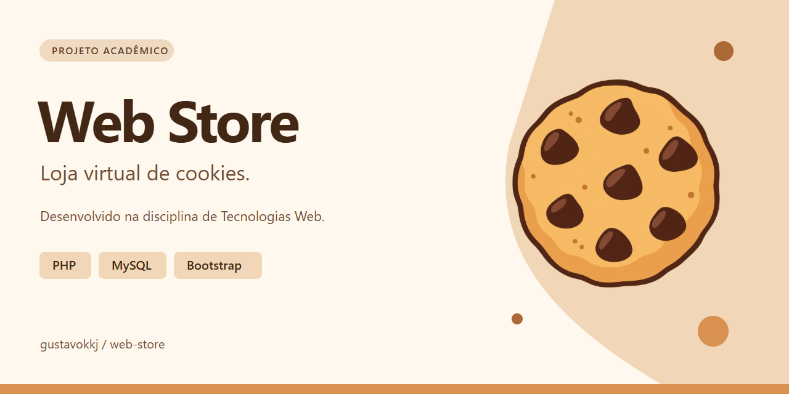
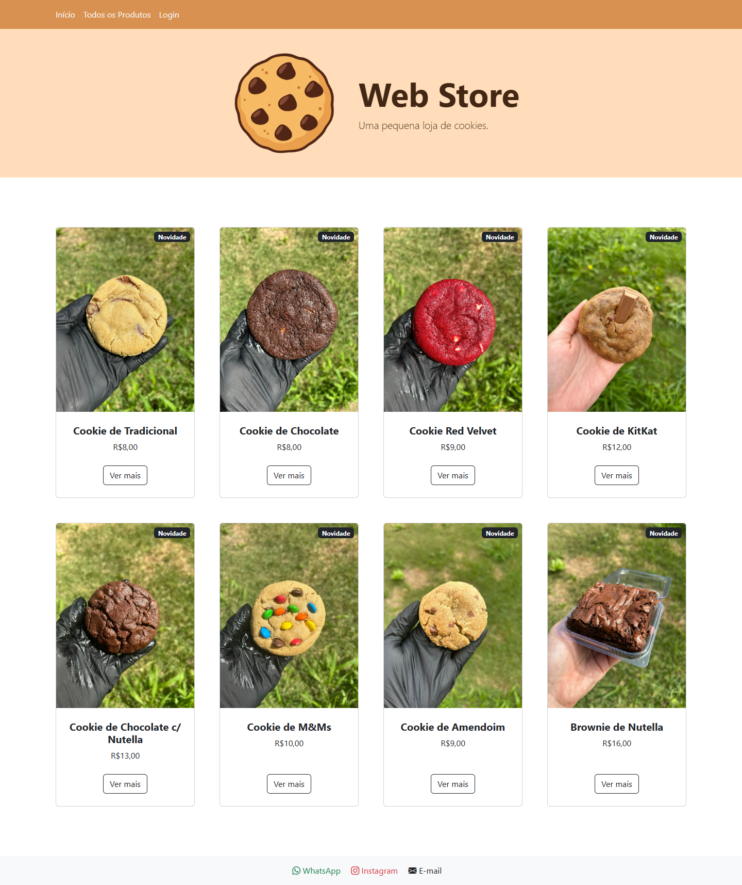
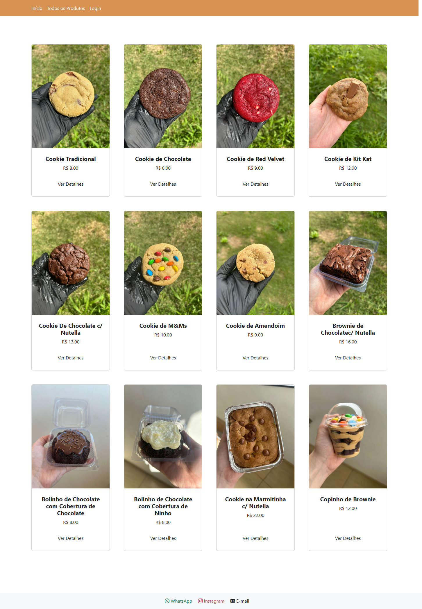
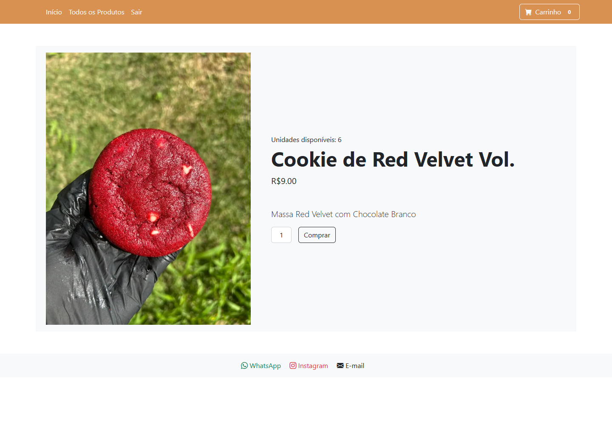
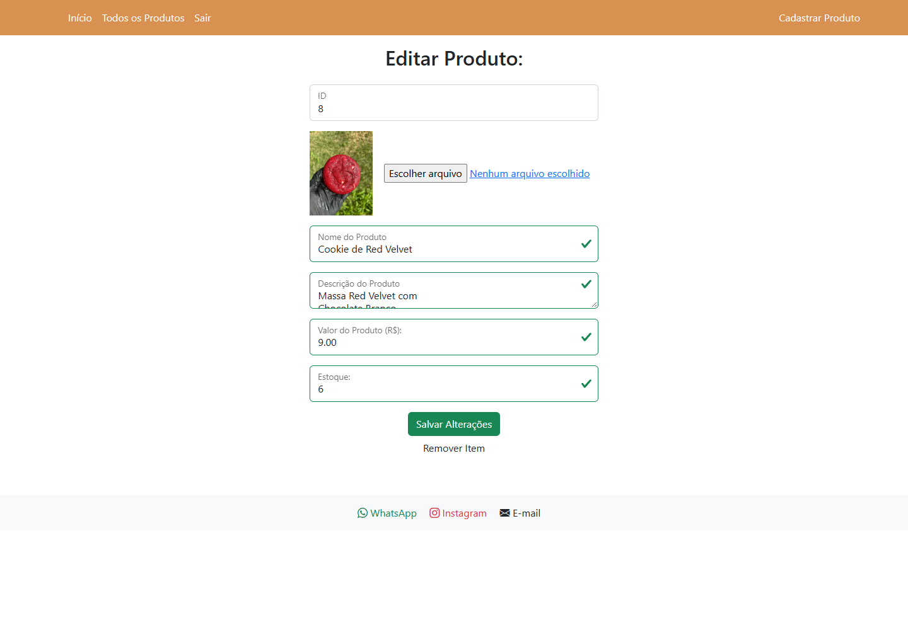

<p align="center">
  
</p>

# Web Store

Loja virtual de cookies com catálogo, cadastro de usuários e uma área administrativa para gerenciar produtos.

## Sobre o projeto

Este projeto foi desenvolvido originalmente como uma atividade acadêmica na disciplina de Tecnologias Web, no primeiro semestre do segundo ano da faculdade. A proposta era criar um site simples utilizando os conhecimentos adquiridos até aquele momento em desenvolvimento web, PHP e banco de dados.

O trabalho representa uma pequena loja de cookies: visitantes consultam o catálogo, clientes criam uma conta e registram compras demonstrativas, e administradores cadastram, editam e removem produtos.

O projeto é apresentado como Web Store, com uma ilustração de cookie utilizada no banner, no ícone do site e na imagem de apresentação.

Posteriormente, o repositório recebeu uma revisão de organização e apresentação. Os arquivos foram agrupados por responsabilidade, os nomes e caminhos foram padronizados e a documentação foi ampliada com instruções de execução, contas de demonstração, capturas das telas e uma imagem de apresentação. O nome e a identidade visual também foram atualizados nessa etapa.

Essas adições mantêm a proposta do trabalho e sua base em PHP, MySQL e Bootstrap. A origem acadêmica e as alterações posteriores permanecem registradas no histórico do Git.

## Telas

| Início | Catálogo de produtos |
| --- | --- |
| [](docs/screenshots/inicio.png) | [](docs/screenshots/produtos.png) |

| Detalhes do produto | Administração |
| --- | --- |
| [](docs/screenshots/produto.png) | [](docs/screenshots/administracao.png) |

Capturas reais do site executado localmente, utilizando os produtos e as contas de demonstração. Clique nas imagens para visualizar em tamanho completo.

## Funcionalidades

- Listagem e visualização de produtos;
- Cadastro e autenticação de usuários;
- Registro de compras demonstrativas;
- Atualização do estoque;
- Cadastro, edição e remoção de produtos por administradores;
- Upload de imagens dos produtos.

## Tecnologias utilizadas

- PHP;
- MySQL/MariaDB;
- HTML e CSS;
- Bootstrap 5;
- Bootstrap Icons;
- jQuery e jQuery Mask.

## Estrutura do projeto

```text
├── actions/       # Processamento de formulários e ações do sistema
├── assets/        # Estilos, imagens e favicon
├── config/        # Configurações da aplicação e do banco de dados
├── database/      # Arquivo SQL do projeto
├── docs/          # Capturas de tela e imagem de apresentação
├── includes/      # Cabeçalho, rodapé e validação de acesso
├── pages/         # Páginas públicas e administrativas
└── index.php      # Página inicial
```

## Como executar

### Requisitos

- XAMPP ou ambiente equivalente com Apache, PHP e MySQL/MariaDB;
- PHP 8.1 ou superior, com a extensão `mysqli`;
- Acesso à internet para carregar os recursos externos de Bootstrap, ícones e jQuery.

### Instalação

1. Clone o repositório dentro da pasta `htdocs` do XAMPP:

   ```bash
   git clone https://github.com/gustavokkj/web-store.git
   ```

2. Inicie os serviços Apache e MySQL.
3. Acesse o phpMyAdmin e crie um banco de dados chamado `cookiesuai`.
4. Importe o arquivo [`database/cookiesuai.sql`](database/cookiesuai.sql).
5. Confira a conexão em [`config/database.php`](config/database.php). Por padrão, ela usa `localhost`, usuário `root`, senha vazia e banco `cookiesuai`. Também é possível definir `DB_HOST`, `DB_USER`, `DB_PASSWORD` e `DB_DATABASE` no ambiente.
6. Abra o projeto pelo endereço correspondente no localhost, por exemplo:

```text
http://localhost/web-store/
```

Se o clone estiver dentro de outra pasta em `htdocs`, inclua essa pasta no endereço. Por exemplo: `http://localhost/ProjetosXampp/web-store/`. O endereço deve corresponder ao nome da pasta local, mesmo que ela tenha um nome diferente do repositório.

## Usuários de demonstração

| Perfil | E-mail | Senha |
| --- | --- | --- |
| Administrador | `adm@teste.com` | `adm` |
| Cliente | `client@teste.com` | `client` |

As contas e senhas acima existem apenas para demonstração local do projeto.

## Escopo da demonstração

- A compra registra os dados no banco e reduz o estoque; não há integração com pagamentos, frete ou entrega.
- O botão de carrinho no cabeçalho é visual e não implementa um carrinho de compras.
- O projeto preserva a implementação acadêmica e é destinado ao estudo e à execução local.

## Créditos

A interface utiliza o template **Shop Homepage**, do Start Bootstrap, e componentes do Bootstrap. Os avisos de autoria e licença desses recursos estão preservados em [`assets/css/styles.css`](assets/css/styles.css).
